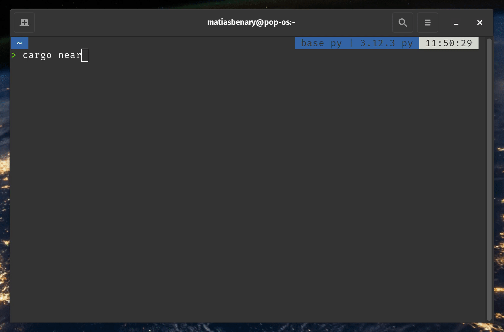

Welcome! [NEAR accounts](../protocol/accounts-contracts/account-model) can store small apps known as smart contracts. In this tutorial, we'll guide you through creating and testing your first contract on NEAR.

Create an auction contract that allows users to place bids, track the highest bidder, and claim tokens at the end of the auction.

---

## Prerequisites

Before starting, make sure to set up your development environment.


```bash
# Install Rust: https://www.rust-lang.org/tools/install
curl --proto '=https' --tlsv1.2 -sSf https://sh.rustup.rs | sh

# Contracts will be compiled to wasm, so we need to add the wasm target
rustup target add wasm32-unknown-unknown

# Install NEAR CLI-RS to deploy and interact with the contract
curl --proto '=https' --tlsv1.2 -LsSf https://github.com/near/near-cli-rs/releases/latest/download/near-cli-rs-installer.sh | sh

# Install cargo near to help building the contract
curl --proto '=https' --tlsv1.2 -LsSf https://github.com/near/cargo-near/releases/latest/download/cargo-near-installer.sh | sh
```


---

## Creating the contract

Create a smart contract with the `cargo near` scaffolding tool by following its instructions:


```bash
# Create a new contract called "auction"
cargo near new auction

# Navigate into the project directory
cd auction
```




<Tip>

For this tutorial, we chose to name the project `auction`, but feel free to use any name you prefer.

</Tip>

---

## How bidding works

The contract in `src/lib.rs` stores the highest bid and the auction's end time. Its `bid` method accepts a deposit, checks that the auction is still open and the new bid is higher, then records the bid and refunds the previous bidder:

{/* github-code
url: https://github.com/near-examples/auctions-tutorial/blob/main/contract-rs/01-basic-auction/src/lib.rs
commit: 4678765ea7f2a584b1a6569786d497dcf75f5261
start: 36
end: 62
fname: lib.rs
language: rust
*/}

```rust title="lib.rs" lines
#[payable]
pub fn bid(&mut self) -> Promise {
    // Assert the auction is still ongoing
    require!(
        env::block_timestamp() < self.auction_end_time.into(),
        "Auction has ended"
    );

    // Current bid
    let bid = env::attached_deposit();
    let bidder = env::predecessor_account_id();

    // Last bid
    let Bid {
        bidder: last_bidder,
        bid: last_bid,
    } = self.highest_bid.clone();

    // Check if the deposit is higher than the current bid
    require!(bid > last_bid, "You must place a higher bid");

    // Update the highest bid
    self.highest_bid = Bid { bidder, bid };

    // Transfer tokens back to the last bidder
    Promise::new(last_bidder).transfer(last_bid)
}
```

<div className="github-source-link">

[See code on GitHub](https://github.com/near-examples/auctions-tutorial/blob/4678765ea7f2a584b1a6569786d497dcf75f5261/contract-rs/01-basic-auction/src/lib.rs#L36-L62)

</div>

{/* /github-code */}

See the [auction tutorial](/web3-apps/tutorials/mastering-near/1.1-basic) for an in-depth guide on the contract's initialization, view methods, and claiming logic.

---

## Test the contract locally

The project includes unit tests and sandbox tests. The sandbox tests build the contract and test it in a local Sandbox, that allows you to simulate a full NEAR environment locally without needing to create a testnet account or use real tokens.


```bash
cargo test
```

The test builds the contract, starts a local blockchain, and prepares a signer for transactions:

```rust title="tests/test_basics.rs" lines
let contract_wasm_path = cargo_near_build::build_with_cli(Default::default())?;
let contract_wasm = std::fs::read(contract_wasm_path)?;
let sandbox = near_sandbox::Sandbox::start_sandbox().await?;
let network = near_api::NetworkConfig::from_rpc_url("sandbox", sandbox.rpc_addr.parse()?);
let signer = near_api::Signer::from_secret_key(
    near_sandbox::config::DEFAULT_GENESIS_ACCOUNT_PRIVATE_KEY.parse()?,
)?;
```

It creates funded accounts for two bidders, the auctioneer, and the contract. All accounts belong to this local sandbox:

```rust title="tests/test_basics.rs" lines
let alice = create_subaccount(&sandbox, "alice.sandbox").await?;
let bob = create_subaccount(&sandbox, "bob.sandbox").await?;
let auctioneer = create_subaccount(&sandbox, "auctioneer.sandbox").await?;
let contract = create_subaccount(&sandbox, "contract.sandbox").await?.as_contract();
```

Next, it deploys and initializes the contract locally, setting the auction to end in one minute:

```rust title="tests/test_basics.rs" lines
let now = std::time::SystemTime::now()
    .duration_since(std::time::UNIX_EPOCH)?.as_secs();
near_api::Contract::deploy(contract.account_id().clone())
    .use_code(contract_wasm)
    .with_init_call("init", json!({
        "end_time": ((now + 60) * 1_000_000_000).to_string(),
        "auctioneer": auctioneer.account_id(),
    }))?
    .with_signer(signer.clone())
    .send_to(&network).await?.assert_success();
```

Alice bids 1 NEAR, then Bob bids 2 NEAR. After each transaction, the test reads the highest bid and checks both the bidder and the amount:

```rust title="tests/test_basics.rs" lines
for (bidder, amount) in [(&alice, 1), (&bob, 2)] {
    contract.call_function("bid", ())
        .transaction()
        .deposit(NearToken::from_near(amount))
        .with_signer(bidder.account_id().clone(), signer.clone())
        .send_to(&network).await?.assert_success();

    // Check the highest bid after each transaction
    let highest_bid: Bid = contract.call_function("get_highest_bid", ())
        .read_only().fetch_from(&network).await?.data;
    assert_eq!(&highest_bid.bidder, bidder.account_id());
    assert_eq!(highest_bid.bid, NearToken::from_near(amount));
}
```

The sandbox can advance the blockchain so the auction ends without waiting a minute. The auctioneer can then claim the proceeds:

```rust title="tests/test_basics.rs" lines
sandbox.fast_forward(200).await?;
contract.call_function("claim", ())
    .transaction()
    .gas(NearGas::from_tgas(30))
    .with_signer(auctioneer.account_id().clone(), signer.clone())
    .send_to(&network).await?.assert_success();
```

Finally, the test checks that the auctioneer's balance includes the winning 2 NEAR bid, minus gas fees, on top of the initial 10 NEAR:

```rust title="tests/test_basics.rs" lines
let balance = auctioneer.tokens().near_balance().fetch_from(&network).await?.total;
assert!(balance > NearToken::from_millinear(11_990));
assert!(balance <= NearToken::from_near(12));
```

Run `cargo test` throughout development to check these interactions locally. Learn more about [unit tests](/smart-contracts/testing/unit-test) and [sandbox tests](/smart-contracts/testing/integration-test).

---

## Deploy and initialize on testnet

When you are ready to make the contract available to others, build it and deploy it to a testnet account. Testnet uses test tokens with no real value.

### Build and create an account

From the `auction` directory, build the contract and create an account to host it. Replace `your-auction.testnet` with your desired account name:

```bash
cargo near build non-reproducible-wasm

CONTRACT_ID=your-auction.testnet
near create-account "$CONTRACT_ID" --useFaucet --networkId testnet
```

<Tip>
**Already have a testnet account?**

If you already have a `testnet` account and would like to use it instead, you can log in with the command `near login`. Set `CONTRACT_ID` to that account's name.
</Tip>

<Accordion title="Got an error on Windows?">

When working in `WSL`—or another headless Linux environment—you might encounter issues creating an account because the CLI tries to save keys to the system keychain.

In such cases, you can try the following command to create the account:

```bash
near account create-account sponsor-by-faucet-service "$CONTRACT_ID" autogenerate-new-keypair save-to-legacy-keychain network-config testnet create
```

</Accordion>

### Deploy and initialize the auction

The contract's `init` function sets the auction end time and the auctioneer who receives the winning bid. Here, we set the end time to five minutes from now, in nanoseconds, and use the contract account as the auctioneer. You can set `AUCTIONEER_ID` to another existing testnet account if you prefer.

Deploy and initialize in the same transaction so the auction is ready to use as soon as it is deployed:

```bash
AUCTIONEER_ID="$CONTRACT_ID"
END_TIME=$(( ($(date +%s) + 300) * 1000000000 ))

near contract deploy "$CONTRACT_ID" \
  use-file ./target/near/auction.wasm \
  with-init-call init json-args "{\"end_time\":\"$END_TIME\",\"auctioneer\":\"$AUCTIONEER_ID\"}" \
  prepaid-gas '100 Tgas' attached-deposit '0 NEAR' \
  network-config testnet sign-with-keychain send
```

The command uses the contract account's key to sign the transaction. After the transaction succeeds, your auction is deployed and initialized on testnet.

### Try placing a bid

To try the auction through the CLI, create a bidder account and place a bid before the five-minute auction ends. Replace `your-bidder.testnet` with your desired account name:

```bash
BIDDER_ID=your-bidder.testnet
near create-account "$BIDDER_ID" --useFaucet --networkId testnet

# Bid 0.01 NEAR
near call "$CONTRACT_ID" bid '{}' --deposit 0.01 --useAccount "$BIDDER_ID" --networkId testnet

# Check the highest bid
near view "$CONTRACT_ID" get_highest_bid '{}' --networkId testnet
```

The result should show your bidder account and a bid of `"10000000000000000000000"` yoctoNEAR, equal to `0.01` NEAR.


## That's it!

You can now interact with the contract through a [frontend](/web3-apps/tutorials/mastering-near/2.1-frontend) or [call its functions directly using the CLI](/smart-contracts/release/deploy#calling-the-contract).


---

## Frequently Asked Questions

<AccordionGroup>

<Accordion title="What about mainnet?">

Once your contract is ready for release, follow the [deployment guide](/smart-contracts/release/deploy) to deploy to mainnet.

</Accordion>

<Accordion title="How much does it cost to deploy?">

The cost of deploying a contract depends on its size: approximately 1 Ⓝ per 100 KB.

</Accordion>

<Accordion title="Can I update a contract after deploying?">

Yes. Redeploy with `near deploy <account> <wasm-file>`. The account stays the same, and the code is updated.

</Accordion>

<Accordion title="How do I test without deploying?">

Run `cargo test` from your project directory. The sandbox tests handle local accounts and contract setup for you, so you can test the contract without a testnet account.

</Accordion>

<Accordion title="Which SDK should I use to write smart contracts?">

Use [near-sdk-rs](/tools/sdk), NEAR's only official smart-contract SDK. It provides the Rust APIs used throughout this guide.

</Accordion>

</AccordionGroup>

---

## Moving forward

<CardGroup cols={3}>
  <Card title="Create a Frontend" href="/web3-apps/tutorials/mastering-near/2.1-frontend">
    Check the auction frontend tutorial to learn how to build a simple web app that interacts with the auction contract.
  </Card>
  <Card title="Extend the Contract" href="/web3-apps/tutorials/mastering-near/3.1-nft">
    Follow the auction NFT tutorial to award the highest bidder a Non-Fungible Token (NFT) and allow users to bid using Fungible Tokens (FT).
  </Card>
  <Card title="Learn More about the SDK" href="/smart-contracts/anatomy/anatomy">
    Check our Anatomy of a Contract page to understand the different components that make up a NEAR smart contract.
  </Card>
</CardGroup>
